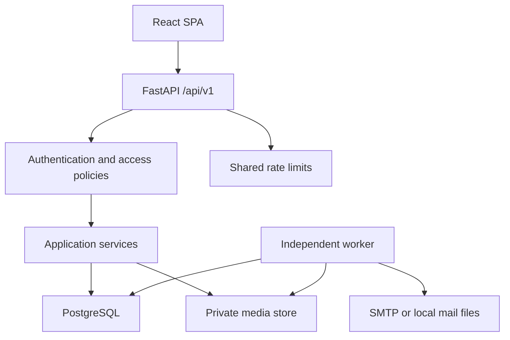

# Architecture

Luma is a modular monolith with an independently deployable SPA. The API owns every authorization decision and durable write. Frontend localStorage holds only the appearance preference, not accounts, tokens, posts, messages, or uploads.

## Runtime boundaries

- React Router handles page routing; TanStack Query owns remote state and invalidation. `lib/api.ts` centralizes JSON errors, cookies, CSRF, refresh single-flight, and upload progress. Mutations wait for server confirmation; no unsupported optimistic success is displayed.
- Focused API modules translate validated Pydantic requests into domain services and SQLAlchemy queries. Reusable policies check public/private visibility, bidirectional blocks, ownership, and conversation membership. Request transaction dependencies commit once or roll back on error.
- Opaque 320-bit random access/refresh tokens are SHA-256 hashed in the database. Access lasts 15 minutes; refresh lasts 30 days by default. No JWT signing secret or refresh token is exposed through API JSON.
- PostgreSQL stores metadata. Local files are development-only. S3 objects remain private; access is checked before a short-lived signed GET URL is issued.
- A database outbox is the durable asynchronous queue. The standalone worker claims mail jobs with row locks and `SKIP LOCKED`, retries failed delivery on subsequent ticks (five attempts), removes expired stories/tokens, and cleans unused media. It does not run inside a serverless function.
- Redis supplies distributed rate-limit counters in production. A bounded-window in-process limiter supports a single development API process. Production fails closed when its configured Redis is unavailable.

## Query strategy

Feeds are chronological by `(created_at DESC, id DESC)` with opaque tuple cursors. The following feed includes your own posts and followed users, excluding muted accounts. Explore includes permitted public and approved private-account posts. Authorization is part of the feed SQL, not an in-memory filter after pagination.

Post media and authors use joined/select-in loading. Like/comment counts, viewer likes, and saves are fetched for the whole page. Conversation previews use a window query for the latest message and a grouped unread query. Large feeds and message histories use cursor pagination; some small management lists (collections, block/mute lists and story viewers) are not paginated yet.

Future ranking belongs in the feed query/service boundary. At higher traffic, add measured indexes for query plans, denormalized counters, cache permitted feed IDs, and fanout jobs. This release makes no recommendation-model or production-scale throughput claim.

## Consistency

Unique constraints and conflict-safe inserts make follow/like/save operations idempotent. An atomic claim on `media_assets` prevents one upload from being attached concurrently to a post, story, avatar, or message. Message retries use `(conversation_id, sender_id, client_id)` and serialize per-conversation writes. Refresh rotation locks the old session; reuse revokes the session family.

Publishing from a retry after a lost response may return a conflict because its media is already attached. The client does not automatically retry post-creation mutations. Notification dedupe keys suppress repeat delivery of the same event; unliking and liking the same post does not create another notification.

## Live updates

The shipped UI polls active message history every 3 seconds, conversations every 5–10 seconds, and notification badges every 15 seconds. Polling is the supported default and is independent of process-local WebSocket state. `/api/v1/ws` validates origin and session, emits only invalidation counters, accepts only `ping`, and rechecks expiry/revocation every cycle. It does not accept message writes. A Redis pub/sub fanout and a socket-driven client can be added when measured scale warrants it.

## Observability and deployment

JSON request logs contain generated request IDs, templated routes, method/status and duration. Passwords, token values, URLs containing query tokens, uploaded bytes, and private message bodies are not logged by this middleware. Use `--no-access-log` in production to prevent a second access logger from capturing query strings.

`/health` is liveness. `/ready` checks database connectivity, migration metadata, and configured Redis. Admin metrics expose per-process request totals, server errors, and cumulative latency, and per-route status counters. Worker completion logs include delivered/failed mail and removed-asset counts. Central metrics, distributed tracing and external error monitoring remain deployment integrations. See OPERATIONS.md for backup, recovery, and retention.

PSYCOPG automatic prepared statements are disabled to support transaction-pooling services. Queries still use bound parameters. Native PostgreSQL is the required production database; SQLite and PGlite are QA accommodations only.
